<a href="docs/readme/hero-dark.webp#gh-dark-mode-only"><picture><source media="(max-width: 767px)" srcset="docs/readme/hero-dark-phone.webp">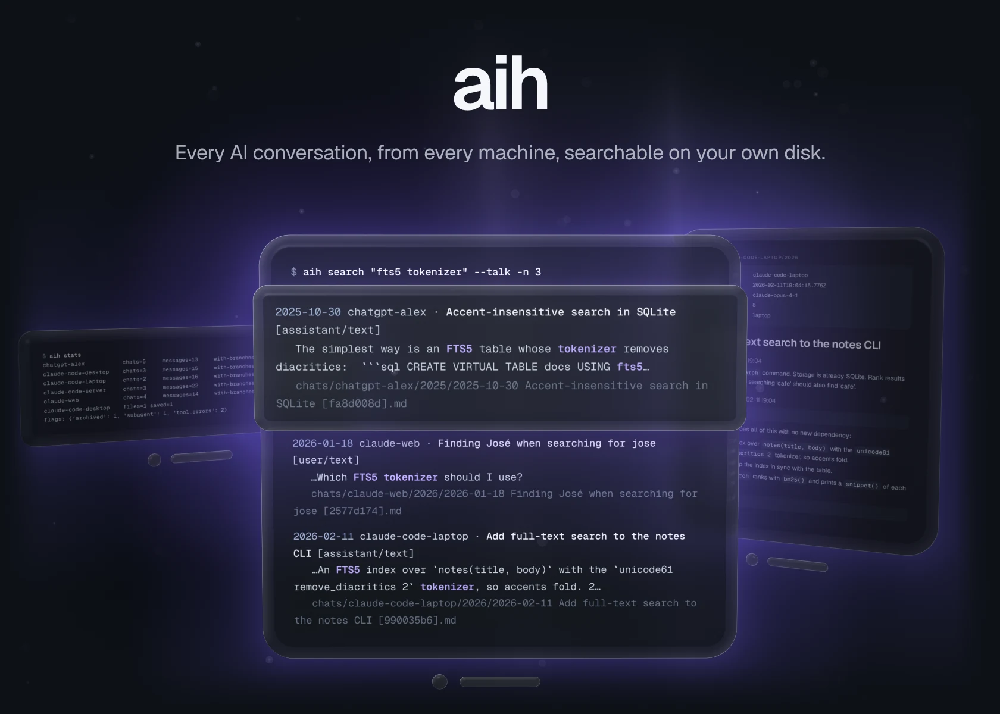</picture></a><a href="docs/readme/hero-light.webp#gh-light-mode-only"><picture><source media="(max-width: 767px)" srcset="docs/readme/hero-light-phone.webp">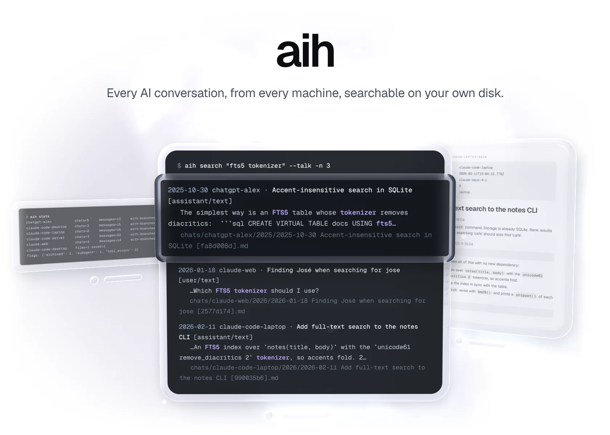</picture></a>

aih keeps every AI conversation you have had, word for word, in one SQLite database on your own disk: claude.ai and ChatGPT exports, and the Claude Code sessions of every machine you use. It collects them every hour, keeps a readable Markdown copy of each chat, and finds anything in milliseconds. It is one standard-library Python file, and it sends your data nowhere.

[Quickstart](#quickstart) &nbsp;·&nbsp; [How it works](#how-it-works) &nbsp;·&nbsp; [Releases](https://github.com/gallowforge/aih/releases)

<a href="docs/readme/numbers-dark.webp#gh-dark-mode-only"><picture><source media="(max-width: 767px)" srcset="docs/readme/numbers-dark-phone.webp">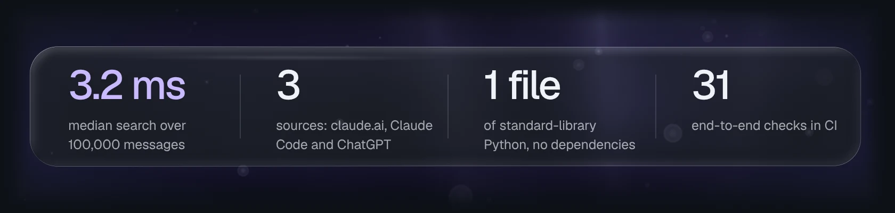</picture></a><a href="docs/readme/numbers-light.webp#gh-light-mode-only"><picture><source media="(max-width: 767px)" srcset="docs/readme/numbers-light-phone.webp">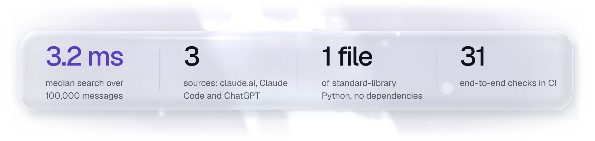</picture></a>

<a href="docs/readme/search-dark.webp#gh-dark-mode-only"><picture><source media="(max-width: 767px)" srcset="docs/readme/search-dark-phone.webp">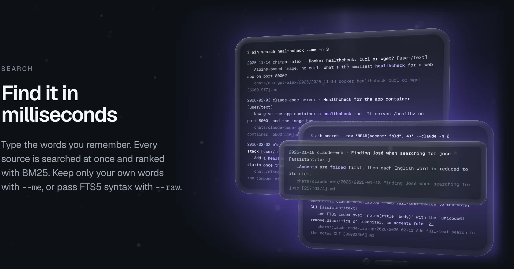</picture></a><a href="docs/readme/search-light.webp#gh-light-mode-only"><picture><source media="(max-width: 767px)" srcset="docs/readme/search-light-phone.webp">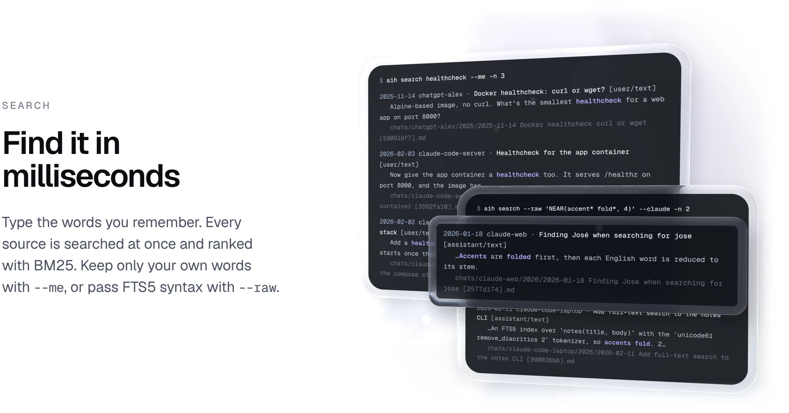</picture></a>

<a href="docs/readme/collect-dark.webp#gh-dark-mode-only"><picture><source media="(max-width: 767px)" srcset="docs/readme/collect-dark-phone.webp">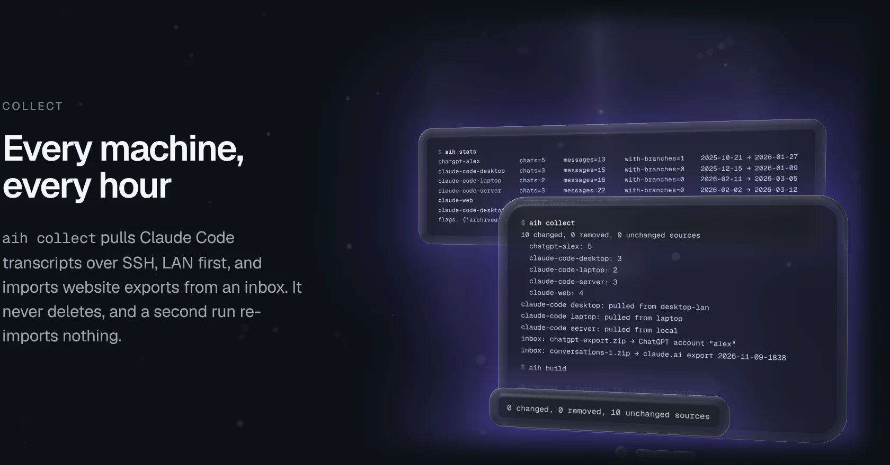</picture></a><a href="docs/readme/collect-light.webp#gh-light-mode-only"><picture><source media="(max-width: 767px)" srcset="docs/readme/collect-light-phone.webp">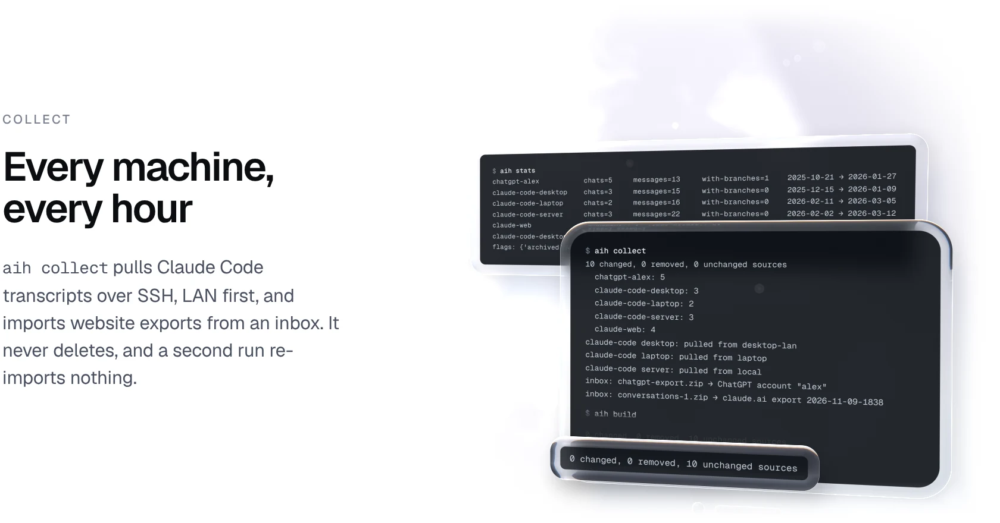</picture></a>

<a href="docs/readme/markdown-dark.webp#gh-dark-mode-only"><picture><source media="(max-width: 767px)" srcset="docs/readme/markdown-dark-phone.webp">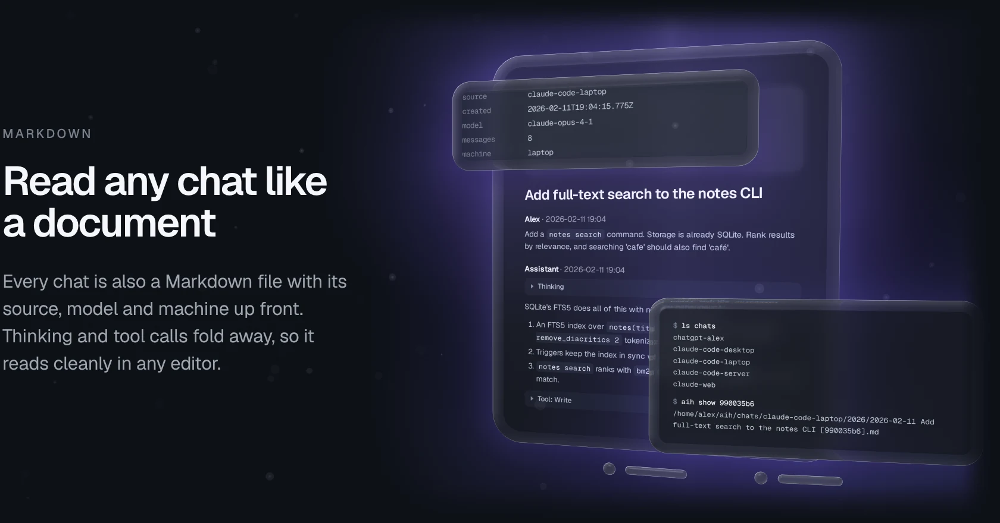</picture></a><a href="docs/readme/markdown-light.webp#gh-light-mode-only"><picture><source media="(max-width: 767px)" srcset="docs/readme/markdown-light-phone.webp">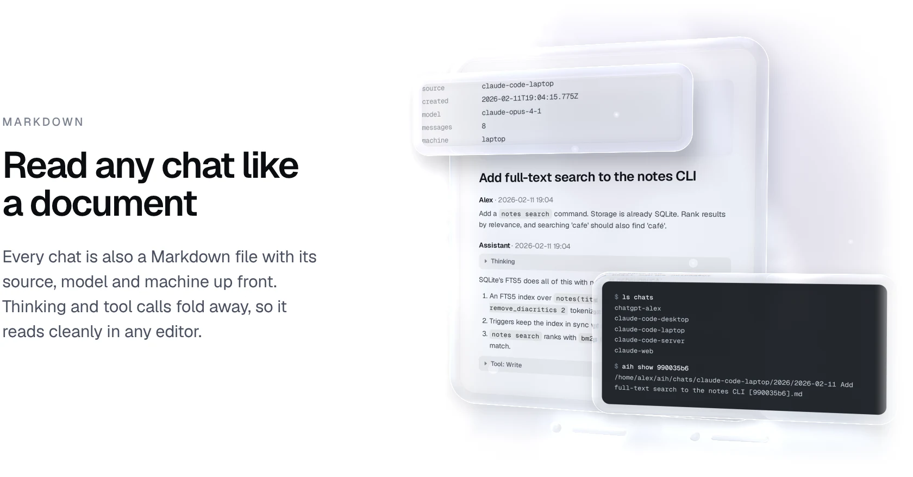</picture></a>

<a href="docs/readme/check-dark.webp#gh-dark-mode-only"><picture><source media="(max-width: 767px)" srcset="docs/readme/check-dark-phone.webp">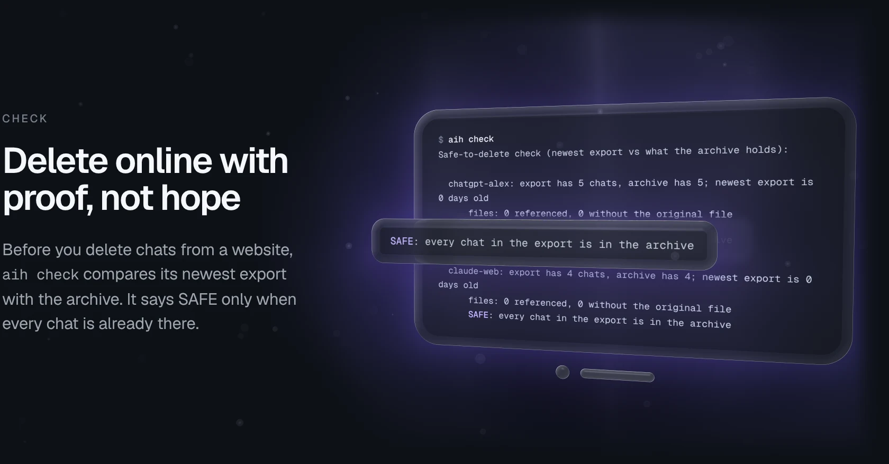</picture></a><a href="docs/readme/check-light.webp#gh-light-mode-only"><picture><source media="(max-width: 767px)" srcset="docs/readme/check-light-phone.webp">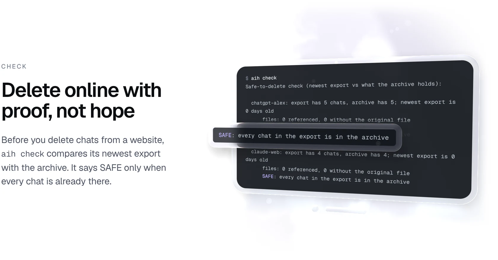</picture></a>

## Quickstart

Python 3.10 or newer, nothing to install.

```bash
git clone https://github.com/gallowforge/aih.git ~/aih && cd ~/aih
./aih collect                    # imports this machine's Claude Code sessions from ~/.claude/projects
./aih search "fts5 tokenizer"
```

- **Website history:** request an export from claude.ai or ChatGPT, move the zip into `inbox/` and run `./aih collect` again.
- **Other machines:** copy `aih.config.example.json` to `aih.config.json`, list each machine with its SSH host aliases (LAN alias first) and name the hub.
- **Every hour:** install the systemd timer.

```bash
mkdir -p ~/.config/systemd/user && cp contrib/systemd/aih-collect.* ~/.config/systemd/user/
systemctl --user daemon-reload && systemctl --user enable --now aih-collect.timer
```

To try it first on made-up data, `scripts/demo-data.py` builds a user called "alex" with three machines and two website exports, plus a stand-in `ssh` that maps each host to a local folder, so the real `aih collect` runs without touching your files:

```bash
python3 scripts/demo-data.py /tmp/aih-demo
HOME=/tmp/aih-demo PATH=/tmp/aih-demo/.demo/bin:$PATH /tmp/aih-demo/aih/aih collect
cd /tmp/aih-demo/aih && ./aih search "fts5 tokenizer"
```

## How it works

`aih.py` turns every source into the same three kinds of row: conversations, messages (a tree, so edited prompts and regenerated answers survive as branches) and parts (text, thinking, tool calls, tool results, attachments). The parts feed an FTS5 index and the Markdown copies.

| Question | Method |
| --- | --- |
| Index | An FTS5 external-content table over part text and chat title, tokenizer `unicode61 remove_diacritics 2`, so `jose` finds José. `system` parts are stored but never indexed. |
| Ranking | FTS5 `rank` (BM25), with snippets of up to 18 tokens and the matches highlighted. |
| Queries | Each word is quoted and the words are ANDed, so punctuation is safe. `--raw` passes FTS5 syntax through: `NEAR`, `OR`, `NOT`, prefixes. |
| Speed | 3.2 ms median query and 45 ms for the whole `aih search` command, over 100,000 synthetic messages on a desktop CPU. A full rebuild of all of them takes 3.8 s. |
| Incremental builds | Every source file is fingerprinted by size and modification time. Changed units are dropped and re-imported; Markdown is rewritten only when it changed. |
| Other machines | `rsync -a` over `ssh -o BatchMode=yes`, `*.jsonl` only, never `--delete`. Host aliases are tried in order until one answers. |
| Resumed sessions | An `owners` table maps each message to the first session that had it, so a resumed Claude Code session stores each message once. |
| Deleted chats | claude.ai exports still list chats you deleted, as empty shells. They are stripped on import and their IDs remembered. |
| One writer | With `hub` set, any other machine refuses `collect` and `build` unless you pass `--force`; it can still search a synced copy. |

<details>
<summary><b>Commands</b></summary>
<br />

| Command | What it does |
| --- | --- |
| `aih collect` | Pull Claude Code transcripts from every machine, import the inbox, rebuild what changed |
| `aih build [--full]` | Re-import changed sources, or everything with `--full` |
| `aih search "words"` | Ranked full-text search. `--me`, `--claude`, `--talk`, `--source`, `--since`, `--newest`, `--raw`, `-n` |
| `aih show <id>` | Path of a conversation's Markdown file |
| `aih stats` | Chats, messages, branches and date range per source |
| `aih check` | Is every chat in the newest website export also in the archive? |
| `aih ingest [dir]` | Unpack `claude-files-*.tar` bundles of original claude.ai uploads |
| `mine.py run [N]` / `mine.py status` | Optional nightly fact mining, or its progress |

Query the database directly with `sqlite3 archive.db`, for example the longest Claude Code sessions:

```sql
SELECT title, n_messages FROM conversations WHERE source LIKE 'claude-code-%' ORDER BY n_messages DESC LIMIT 10;
```

</details>

<details>
<summary><b>Database schema</b></summary>
<br />

| Table | Holds |
| --- | --- |
| `conversations` | One row per chat: source, title, created, updated, model, URL, Markdown path, message and branch counts, flags, extra (JSON) |
| `messages` | The message tree: id, parent, role, created, and whether it is on the main line |
| `parts` | The text, one row per block: `text`, `thinking`, `tool_use`, `tool_result`, `attachment`, `system` |
| `files` | Uploaded and generated files and where the original is stored |
| `parts_fts` | The FTS5 index over part text and chat title |
| `units`, `owners` | Source fingerprints for incremental builds, and the first owner of each message |

</details>

<details>
<summary><b>Configuration</b></summary>
<br />

Everything works without a config file. For several machines or mining, copy `aih.config.example.json` to `aih.config.json` (or point `AIH_CONFIG` at it).

| Key | Default | Meaning |
| --- | --- | --- |
| `user_name` | `You` | Heading for your messages in the Markdown files |
| `machines` | this machine only | Machine name to SSH host aliases, tried in order (LAN alias first) |
| `hostnames` | none | OS hostname to machine name, so the local machine reads its own folder directly |
| `hub` | none | The only machine allowed to write |
| `inbox` | `./inbox` | Where exports are dropped. Also `AIH_INBOX` |
| `mining.*` | see the example | Knowledge base folder, profile files, review inbox, Claude Code CLI and the two models for `mine.py` |

</details>

<details>
<summary><b>Optional fact mining and privacy</b></summary>
<br />

`mine.py` runs nightly if you turn it on. A fast model reads only your own messages and extracts dated facts; a second, stronger model checks them against a Markdown profile you maintain. Only new facts and real conflicts are written, as notes for you to review, and the profile is never edited. It is the one part that sends text to a model, through the Claude Code CLI, and by instruction it skips credentials, ID numbers and other people's sensitive matters.

Everything else stays on your machines: aih makes no network calls of its own, and the only traffic is `rsync` over your own SSH hosts. The `.gitignore` blocks the database, `chats/`, `sources/`, `raw/`, `inbox/`, `mining/` and your config, so a fork cannot leak an archive. [`CLAUDE.md`](CLAUDE.md) tells agents working in an archive to treat it as evidence, never to edit `sources/`, and never to publish it.

</details>

## Quality

| Check | What it covers |
| --- | --- |
| End-to-end smoke test, 31 checks | Builds the synthetic setup and runs the real `collect`, `build`, `search`, `stats`, `show` and `check`: alias fallback, inbox routing, incremental rebuilds, the hub rule, deleted chats, resumed sessions, branches, every filter, FTS5 syntax, accent folding and the Markdown output. |
| Python 3.10 and 3.13 | [CI](https://github.com/gallowforge/aih/actions/workflows/ci.yml) runs the smoke test on the oldest supported Python and a current one, on every push. |
| Syntax | Every Python file is compiled and every shell script parsed. |
| Honest pictures | Every window above shows real output of aih on synthetic data, captured by `scripts/readme-visuals.sh` in a private namespace. |

## FAQ

<details>
<summary><b>Does anything leave my machine?</b></summary>
<br />
No. aih reads files and writes files, and the only traffic is <code>rsync</code> between your own machines over SSH. The optional <code>mine.py</code> is the one exception, and only if you turn it on.
</details>

<details>
<summary><b>What happens when Claude Code deletes old transcripts?</b></summary>
<br />
Nothing is lost. Claude Code deletes transcripts older than 30 days by default, but <code>rsync</code> runs without <code>--delete</code>, so every transcript ever collected stays in <code>sources/</code> and in the archive.
</details>

<details>
<summary><b>Can I search on my laptop if the server holds the archive?</b></summary>
<br />
Yes. Sync the folder to the laptop read-only with any file sync tool. Search works anywhere, and <code>collect</code> and <code>build</code> refuse to run anywhere but the hub, so two machines never write at once.
</details>

<details>
<summary><b>Does it change or summarise anything?</b></summary>
<br />
No. Every message is kept word for word, including thinking and tool output. System noise is stored too; it is only kept out of the search index and the Markdown.
</details>

<details>
<summary><b>Are the chats in these pictures real?</b></summary>
<br />
No. They are synthetic, generated by <code>scripts/demo-data.py</code> for a made-up user on made-up machines. The commands and their output are real.
</details>

## Contributing

Issues and pull requests are welcome; run `bash scripts/smoke-test.sh` first, and `scripts/readme-visuals.sh` if a change alters the output shown above.

## Licence

[MIT](LICENSE)
