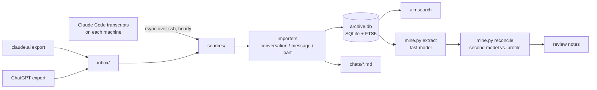

# aih

Every AI conversation you have had, from claude.ai, Claude Code on several machines and ChatGPT, in one local SQLite database with full-text search.

Chat history is spread across websites that change their exports, and laptops that delete old Claude Code transcripts. aih copies all of it into one place, keeps it word for word, and makes it searchable in milliseconds.

## Quickstart

```bash
git clone https://github.com/gallowforge/aih.git && cd aih
./aih collect                    # imports this machine's Claude Code sessions from ~/.claude/projects
./aih search "fts5 tokenizer"
```

To add website history, move a claude.ai or ChatGPT export into `inbox/` and run `./aih collect` again.

## Features

- **Three sources, one model.** claude.ai official exports (original uploads linked when present), Claude Code JSONL transcripts, and ChatGPT exports (several accounts) all become the same conversation, message and part rows.
- **Full-text search.** An SQLite FTS5 index (`unicode61`, diacritics folded) with BM25 ranking and highlighted snippets. Filter to your own words (`--me`), answers only (`--claude`), no tool output (`--talk`), one source, or a start date. `--raw` takes FTS5 syntax such as `NEAR/5` and `prefix*`.
- **Markdown copies.** One readable file per conversation under `chats/<source>/<year>/`, with front matter. Thinking and tool calls are folded into `<details>`, images are linked, and edited or regenerated branches are listed after the main line.
- **Incremental and hourly.** Each source file is fingerprinted. `aih collect` re-imports only what changed, so a run takes seconds. A systemd timer runs it every hour (`contrib/systemd/`).
- **Several machines.** `collect` pulls `~/.claude/projects` from every machine over SSH with `rsync`, and never deletes, so transcripts a machine prunes stay in the archive. One machine (the hub) writes; the others can hold a synced read-only copy and still search.
- **Faithful by default.** Nothing is summarised or corrected. Resumed Claude Code sessions are de-duplicated: each message is kept once, in the session where it first appeared. System noise (reminders, hook output, memory snapshots) is stored but kept out of the index. Chats deleted on claude.ai are never imported, even though exports still list them.
- **Safe-to-delete check.** `aih check` compares the newest website export with the archive before you delete anything online.
- **Optional fact mining.** `mine.py` runs nightly. A fast model extracts dated facts from your own messages. A second, stronger model then checks them against a Markdown profile you maintain. Only new facts and real conflicts are written, as notes for review; the profile itself is never edited.

## Architecture



`aih.py` is one standard-library Python file. `aih` is a symlink to it.

## Commands

| Command | What it does |
|---|---|
| `aih collect` | Pull Claude Code transcripts from every machine, import the inbox, rebuild what changed |
| `aih build [--full]` | Re-import changed sources, or everything with `--full` |
| `aih search "words"` | Ranked full-text search. `--me`, `--claude`, `--talk`, `--source`, `--since`, `--newest`, `--raw`, `-n` |
| `aih show <id>` | Path of a conversation's Markdown file |
| `aih stats` | Chats, messages, branches and date range per source |
| `aih check` | Is every chat in the newest website export also in the archive? |
| `aih ingest [dir]` | Unpack `claude-files-*.tar` bundles of original claude.ai uploads |
| `mine.py run [N]` / `mine.py status` | Mine new messages (optionally only N batches), or show progress |

## Schema

| Table | Holds |
|---|---|
| `conversations` | One row per chat: source, title, created, updated, model, URL, Markdown path, message and branch counts, flags, extra (JSON) |
| `messages` | Message tree: id, parent, role, created, and whether it is on the main line |
| `parts` | The text, one row per block: `text`, `thinking`, `tool_use`, `tool_result`, `attachment`, `system`, with role and metadata |
| `files` | Uploaded and generated files and where the original is stored |
| `parts_fts` | FTS5 index over part text and chat title (external content, `system` parts excluded) |
| `units`, `owners` | Bookkeeping: source fingerprints for incremental builds, and first owner of each message for de-duplication |

Query it directly with `sqlite3 archive.db`. For example, the longest Claude Code sessions:

```sql
SELECT title, n_messages FROM conversations WHERE source LIKE 'claude-code-%' ORDER BY n_messages DESC LIMIT 10;
```

## Configuration

Everything works without a config file. To set up several machines or mining, copy `aih.config.example.json` to `aih.config.json` (or point `AIH_CONFIG` at it).

| Key | Default | Meaning |
|---|---|---|
| `user_name` | `You` | Heading for your messages in the Markdown files |
| `machines` | this machine only | Machine name to SSH host aliases, tried in order (LAN alias first) |
| `hostnames` | none | OS hostname to machine name, so the local machine reads its own folder directly |
| `hub` | none | The only machine allowed to write. Others refuse `collect` and `build` unless `--force` |
| `inbox` | `./inbox` | Where exports are dropped. Also `AIH_INBOX` |
| `mining.kb_dir` | `~/kb` | Knowledge base root |
| `mining.profile_glob` | `profile/[0-9][0-9]-*.md` | Profile sections, one Markdown file per topic |
| `mining.inbox` | `<kb_dir>/inbox` | Where review notes are written |
| `mining.claude` | `claude` | Claude Code CLI used for headless model calls |
| `mining.extract_model`, `mining.verify_model` | `sonnet`, `opus` | The extracting model and the checking model |
| `mining.host` | none | Restrict mining to one hostname |

Files dropped in the inbox are imported once they have not changed for two minutes, so a sync in progress is never read half-written. Imported files are kept in `inbox/.imported/` for 30 days.

## Privacy

Everything stays on your machines. aih makes no network calls of its own. The only traffic is `rsync` over your own SSH hosts. `mine.py` is the exception you opt into: it sends your messages to a model through the Claude Code CLI, and it skips credentials, ID numbers and other people's sensitive matters by instruction. The `.gitignore` blocks the database, `chats/`, `sources/`, `raw/`, `mining/` and your config, so a fork cannot leak your archive by accident.

## Requirements

- Python 3.10+, standard library only (SQLite with FTS5, included in most builds)
- `rsync` and `ssh` for collecting from other machines
- Claude Code CLI, only for `mine.py`

## Licence

MIT
