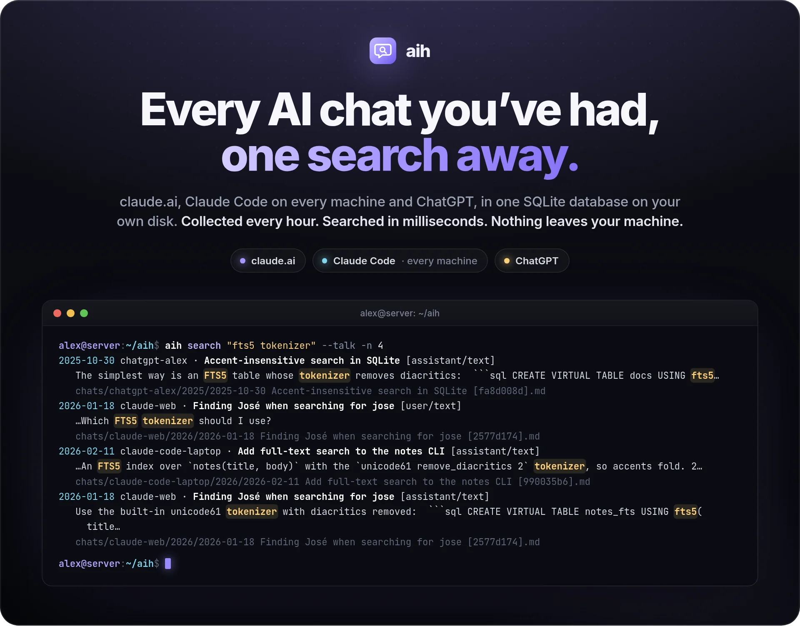
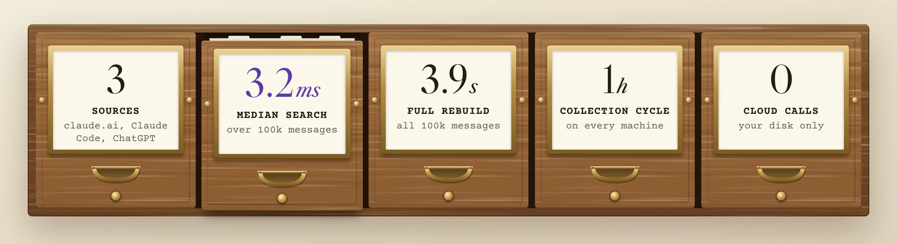
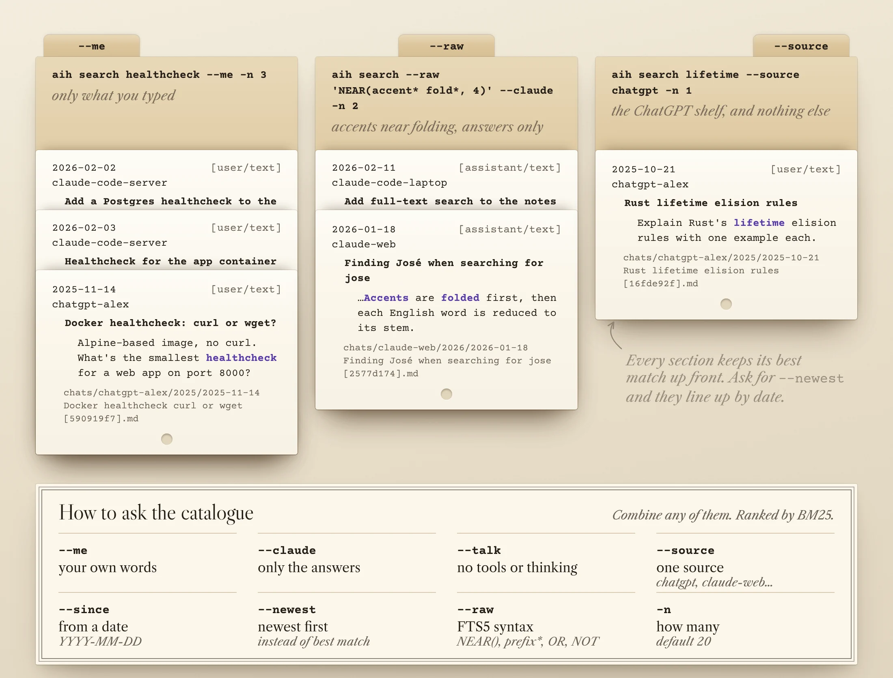
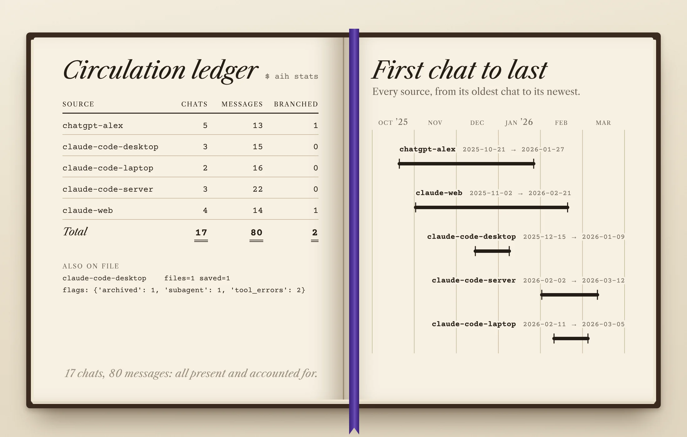
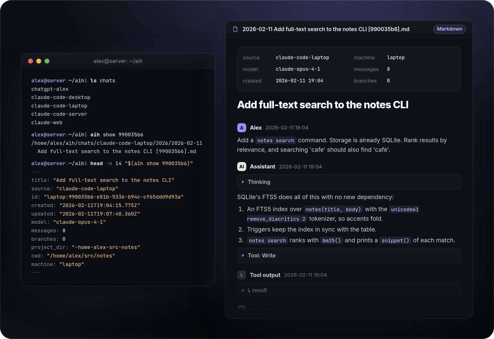
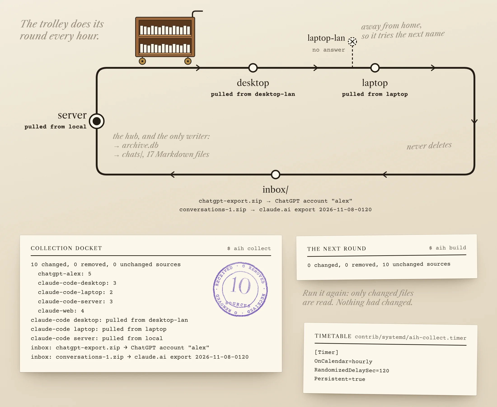
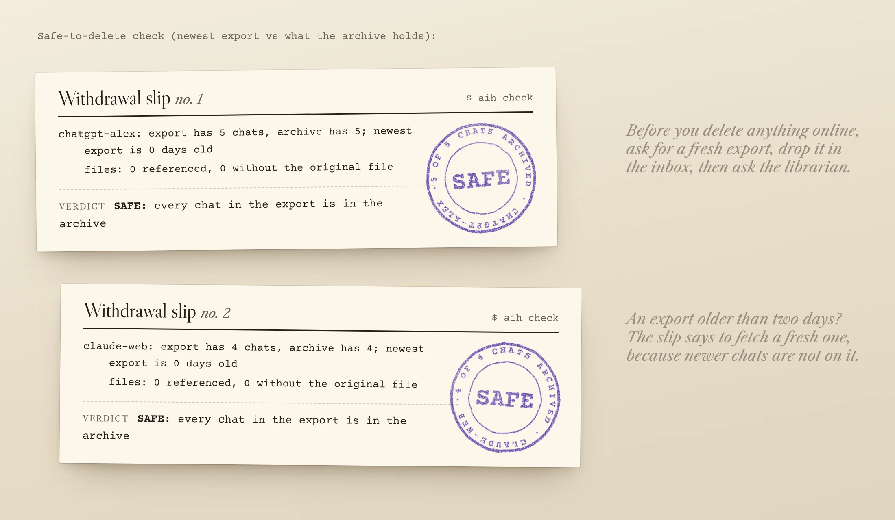
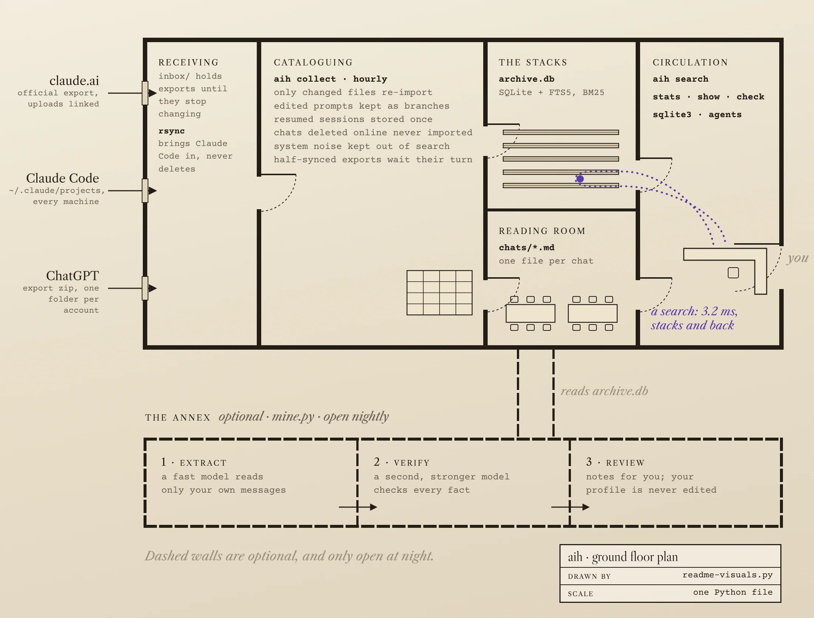

<picture>
  <source media="(max-width: 700px)" srcset="docs/readme/hero-mobile.webp" />
  
</picture>

<p align="center">
  <a href="#quickstart"><b>Quickstart</b></a>
  &nbsp;·&nbsp;
  <a href="#how-it-works">How it works</a>
  &nbsp;·&nbsp;
  <a href="#commands">Commands</a>
  &nbsp;·&nbsp;
  <a href="#faq">FAQ</a>
  &nbsp;·&nbsp;
  <a href="https://gallowforge.github.io/">More projects</a>
</p>

<p align="center">
  <a href="https://github.com/gallowforge/aih/actions/workflows/ci.yml"></a>
  
  
  
  
</p>

<br />

Your AI conversations hold months of decisions, fixes and half-finished ideas, and they are scattered across shelves you do not own. claude.ai and ChatGPT keep them on their own servers, one account at a time. Claude Code keeps them on each machine separately, and deletes transcripts older than 30 days by default.

**aih is the card catalogue: every conversation, word for word, in one SQLite database on your own disk, and anything in it found in milliseconds.** It collects from all your machines every hour, keeps a readable Markdown copy of each chat, and never sends your data anywhere. Nothing leaves the building.

<picture>
  <source media="(max-width: 700px)" srcset="docs/readme/numbers-mobile.webp" />
  
</picture>

<br />

## Find it in milliseconds

Type the words you remember. aih searches every chat from every source at once and hands you the cards: where each match is, who said it, and the file to open.

- **Ranked and highlighted.** SQLite FTS5 ranks results with BM25. Each hit shows the date, the source, the chat title, who said it, the matching words in context, and the chat's Markdown file.
- **Filter by who said it.** `--me` keeps only your own words, `--claude` only the answers, and `--talk` skips tool output and thinking. Narrow further with `--source`, `--since` and `--newest`.
- **Accents never get in the way.** The tokenizer folds diacritics, so `jose` finds José and `resume` finds résumé.
- **Full FTS5 syntax when you need it.** `--raw` passes the query through: `NEAR(caddy certificate, 8)`, `tokeni*`, `OR`, `NOT`.

<picture>
  <source media="(max-width: 700px)" srcset="docs/readme/search-mobile.webp" />
  
</picture>

## Every source, one catalogue

- **Three sources, one model.** claude.ai official exports, Claude Code JSONL transcripts and ChatGPT exports (several accounts) all become the same conversation, message and part rows.
- **Nothing is flattened.** Edited prompts and regenerated answers are kept as branches. Thinking, tool calls and tool output are kept. Original uploads are linked when you have them.
- **Know what you have.** `aih stats` shows chats, messages, branches and the date range of every source, plus saved files and flags: subagent transcripts, tool errors, archived chats, chats deleted online.

<picture>
  <source media="(max-width: 700px)" srcset="docs/readme/stats-mobile.webp" />
  
</picture>

## Read any chat like a document

- **One Markdown file per chat,** under `chats/<source>/<year>/`, with front matter for the source, model, machine and message count. It opens in any editor or in Obsidian.
- **Clean to read.** Thinking and tool calls fold into `<details>`, images are linked, and edited or regenerated branches are listed after the main line.
- **Easy to find.** `aih show <id>` prints a chat's path, and `INDEX.md` lists every chat by source and date.

<picture>
  <source media="(max-width: 700px)" srcset="docs/readme/markdown-mobile.webp" />
  
</picture>

## Every machine, collected every hour

- **Pulls over SSH and never deletes.** `aih collect` copies `~/.claude/projects` from each machine with `rsync`, trying each host alias in order, LAN first. Transcripts a machine prunes stay in the archive.
- **Incremental.** Every source file is fingerprinted, so a run re-imports only what changed. A systemd timer runs it every hour (`contrib/systemd/`).
- **Drop exports in the inbox.** claude.ai and ChatGPT export zips are recognised and routed. A file still syncing is left alone until it has not changed for two minutes.
- **One writer, any number of readers.** Only the hub writes. Other machines can hold a synced, read-only copy and still search.

<picture>
  <source media="(max-width: 700px)" srcset="docs/readme/collect-mobile.webp" />
  
</picture>

## Delete online with proof, not hope

- **Proof before you delete.** `aih check` compares the newest export of each account with the archive. Only when every chat in the export is archived does it say SAFE.
- **Fresh exports only.** An export older than two days covers nothing newer, so the check asks you to request a fresh one first.
- **Deleted stays deleted.** Exports still list chats you deleted on claude.ai, as empty shells. aih never imports them and remembers their IDs.

<picture>
  <source media="(max-width: 700px)" srcset="docs/readme/check-mobile.webp" />
  
</picture>

## How it works

<picture>
  <source media="(max-width: 700px)" srcset="docs/readme/architecture-mobile.webp" />
  
</picture>

`aih.py` is one standard-library Python file, and `aih` is a symlink to it. Every source becomes the same three kinds of row: conversations, messages (a tree, so branches survive) and parts (text, thinking, tool calls, tool results, attachments). The parts feed an FTS5 index and the Markdown copies.

**Optional fact mining.** `mine.py` runs nightly if you want it. A fast model reads only your own messages and extracts dated facts. A second, stronger model then checks them against a Markdown profile you maintain. Only new facts and real conflicts are written, as notes for you to review; the profile itself is never edited.

## Why it is different

|                         | aih                                            | The usual way                                |
| ----------------------- | ---------------------------------------------- | -------------------------------------------- |
| Where chats live        | One SQLite file on your disk                   | On each service's servers, one account each  |
| Claude Code transcripts | Kept for good, from every machine              | Deleted after 30 days by default, per machine |
| Search                  | Ranked full text across every source           | One site or one folder at a time             |
| Filters                 | Your words, answers, source, date, FTS5 syntax | Whatever each site offers                    |
| Offline                 | Yes                                            | Needs the website                            |
| Before deleting online  | `aih check` proves every chat is archived      | Hope the export was complete                 |
| Format                  | SQLite and Markdown, readable without aih      | Export JSON that changes shape               |

## Quickstart

```bash
git clone https://github.com/gallowforge/aih.git ~/aih && cd ~/aih
./aih collect                    # imports this machine's Claude Code sessions from ~/.claude/projects
./aih search "fts5 tokenizer"
```

**Add website history.** Request an export from claude.ai or ChatGPT, move the zip into `inbox/`, and run `./aih collect` again.

**Add your other machines.** Copy `aih.config.example.json` to `aih.config.json`, list each machine with its SSH host aliases (LAN alias first), and name the hub.

**Collect every hour.**

```bash
mkdir -p ~/.config/systemd/user && cp contrib/systemd/aih-collect.* ~/.config/systemd/user/
systemctl --user daemon-reload && systemctl --user enable --now aih-collect.timer
```

**Try it on demo data first.** `scripts/demo-data.py` builds a made-up user, "alex", with three machines and two website exports. Its stand-in `ssh` maps each host to a local folder, so the real `aih collect` runs without touching your files:

```bash
python3 scripts/demo-data.py /tmp/aih-demo
HOME=/tmp/aih-demo PATH=/tmp/aih-demo/.demo/bin:$PATH /tmp/aih-demo/aih/aih collect
cd /tmp/aih-demo/aih && ./aih search "fts5 tokenizer"
```

## Commands

| Command                              | What it does                                                                                               |
| ------------------------------------ | ---------------------------------------------------------------------------------------------------------- |
| `aih collect`                        | Pull Claude Code transcripts from every machine, import the inbox, rebuild what changed                    |
| `aih build [--full]`                 | Re-import changed sources, or everything with `--full`                                                     |
| `aih search "words"`                 | Ranked full-text search. `--me`, `--claude`, `--talk`, `--source`, `--since`, `--newest`, `--raw`, `-n`    |
| `aih show <id>`                      | Path of a conversation's Markdown file                                                                     |
| `aih stats`                          | Chats, messages, branches and date range per source                                                        |
| `aih check`                          | Is every chat in the newest website export also in the archive?                                            |
| `aih ingest [dir]`                   | Unpack `claude-files-*.tar` bundles of original claude.ai uploads                                          |
| `mine.py run [N]` / `mine.py status` | Mine new messages (optionally only N batches), or show progress                                            |

Query the database directly with `sqlite3 archive.db`. For example, the longest Claude Code sessions:

```sql
SELECT title, n_messages FROM conversations WHERE source LIKE 'claude-code-%' ORDER BY n_messages DESC LIMIT 10;
```

## Under the hood

<details>
<summary><b>How each part works</b></summary>
<br />

| Question             | Method                                                                                                                                                                       |
| -------------------- | ---------------------------------------------------------------------------------------------------------------------------------------------------------------------------- |
| Index                | An FTS5 external-content table over part text and chat title, tokenizer `unicode61 remove_diacritics 2`. `system` parts are stored but never indexed.                        |
| Ranking and snippets | FTS5 `rank` (BM25). Snippets of up to 18 tokens with the matches highlighted.                                                                                                |
| Queries              | Each word is quoted and the words are ANDed, so punctuation is safe. `--raw` passes FTS5 syntax through unchanged.                                                           |
| Speed                | 3.2 ms median query, and under 50 ms for the whole `aih search` command including Python start-up, over 100,000 synthetic messages on a desktop CPU. A full rebuild of all of them takes 3.9 s.                |
| Incremental builds   | Every source file is a unit fingerprinted by size and modification time (the claude.ai export is one hashed unit). Changed units are dropped and re-imported; Markdown is rewritten only when it changed. |
| Branches             | Messages form a tree by parent ID. The main line is the current leaf (claude.ai live metadata, ChatGPT `current_node`) or else the newest leaf; Claude Code sessions are linear. |
| Resumed sessions     | An `owners` table maps each message ID to the first session that had it, and the oldest files are imported first, so each message is stored once.                            |
| System noise         | Claude Code reminders, hook and command output, interruption markers and continuation summaries are recognised by their tags and stored as `system` parts.                   |
| Deleted chats        | claude.ai export entries whose messages are all empty are stripped on import, and their IDs are kept in `sources/claude-web/deleted-chat-ids.txt`.                          |
| Inbox                | A file is imported once it has been unchanged for two minutes. ChatGPT zips are recognised by their contents, claude.ai zips by name. Imported files are kept 30 days.       |
| Other machines       | `rsync -a` over `ssh -o BatchMode=yes`, `*.jsonl` only, never `--delete`. Host aliases are tried in order until one answers.                                                 |
| One writer           | With `hub` set, any other machine refuses `collect` and `build` unless you pass `--force`.                                                                                   |

The speed figures come from `scripts/readme-capture.sh`, which builds the synthetic archive and times ten two-word queries.

</details>

<details>
<summary><b>Database schema</b></summary>
<br />

| Table             | Holds                                                                                                                         |
| ----------------- | ----------------------------------------------------------------------------------------------------------------------------- |
| `conversations`   | One row per chat: source, title, created, updated, model, URL, Markdown path, message and branch counts, flags, extra (JSON)  |
| `messages`        | Message tree: id, parent, role, created, and whether it is on the main line                                                   |
| `parts`           | The text, one row per block: `text`, `thinking`, `tool_use`, `tool_result`, `attachment`, `system`, with role and metadata    |
| `files`           | Uploaded and generated files and where the original is stored                                                                 |
| `parts_fts`       | FTS5 index over part text and chat title (external content, `system` parts excluded)                                          |
| `units`, `owners` | Bookkeeping: source fingerprints for incremental builds, and the first owner of each message for de-duplication              |

</details>

<details>
<summary><b>Configuration</b></summary>
<br />

Everything works without a config file. To set up several machines or mining, copy `aih.config.example.json` to `aih.config.json` (or point `AIH_CONFIG` at it).

| Key                                           | Default                   | Meaning                                                                               |
| --------------------------------------------- | ------------------------- | ------------------------------------------------------------------------------------- |
| `user_name`                                   | `You`                     | Heading for your messages in the Markdown files                                       |
| `machines`                                    | this machine only         | Machine name to SSH host aliases, tried in order (LAN alias first)                    |
| `hostnames`                                   | none                      | OS hostname to machine name, so the local machine reads its own folder directly       |
| `hub`                                         | none                      | The only machine allowed to write. Others refuse `collect` and `build` unless `--force` |
| `inbox`                                       | `./inbox`                 | Where exports are dropped. Also `AIH_INBOX`                                           |
| `mining.kb_dir`                               | `~/kb`                    | Knowledge base root                                                                   |
| `mining.profile_glob`                         | `profile/[0-9][0-9]-*.md` | Profile sections, one Markdown file per topic                                         |
| `mining.inbox`                                | `<kb_dir>/inbox`          | Where review notes are written                                                        |
| `mining.claude`                               | `claude`                  | Claude Code CLI used for headless model calls                                         |
| `mining.extract_model`, `mining.verify_model` | `sonnet`, `opus`          | The extracting model and the checking model                                           |
| `mining.host`                                 | none                      | Restrict mining to one hostname                                                       |

</details>

<details>
<summary><b>Privacy</b></summary>
<br />

Everything stays on your machines. aih makes no network calls of its own; the only traffic is `rsync` over your own SSH hosts. `mine.py` is the exception you opt into: it sends your own messages to a model through the Claude Code CLI, and by instruction it skips credentials, ID numbers and other people's sensitive matters.

The `.gitignore` blocks the database, `chats/`, `sources/`, `raw/`, `inbox/`, `mining/` and your config, so a fork cannot leak an archive by accident. [`CLAUDE.md`](CLAUDE.md) tells agents working in an archive to treat it as evidence, never to edit `sources/`, and never to publish it.

</details>

<details>
<summary><b>Requirements</b></summary>
<br />

- Python 3.10 or newer, standard library only (SQLite with FTS5, included in most builds)
- `rsync` and `ssh` for collecting from other machines
- Claude Code CLI, only for `mine.py`

</details>

## Quality

| Check                            | What it covers                                                                                                                                                                                                                              |
| -------------------------------- | ------------------------------------------------------------------------------------------------------------------------------------------------------------------------------------------------------------------------------------------- |
| End-to-end smoke test, 31 checks | Builds the synthetic setup and runs the real `collect`, `build`, `search`, `stats`, `show` and `check`: alias fallback, inbox routing, incremental rebuilds, the hub rule, deleted chats, resumed sessions, branches, flags, every filter, FTS5 syntax, accent folding and the Markdown output. |
| Python 3.10 and 3.13             | CI runs the smoke test on the oldest supported Python and a current one.                                                                                                                                                                   |
| Syntax                           | Every Python file is compiled and every shell script parsed on each push.                                                                                                                                                                  |
| Honest pictures                  | Every card, slip and ledger in this README carries real output from `scripts/readme-visuals.sh`, run on synthetic data in a private namespace.                                                                                            |

## FAQ

<details>
<summary><b>Does anything leave my machine?</b></summary>
<br />
No. aih reads files and writes files. The only network traffic is <code>rsync</code> between your own machines over SSH. The optional <code>mine.py</code> is the one exception, and only if you turn it on.
</details>

<details>
<summary><b>What happens when Claude Code deletes old transcripts?</b></summary>
<br />
Nothing is lost. <code>rsync</code> runs without <code>--delete</code>, so every transcript ever collected stays in <code>sources/</code> and in the archive.
</details>

<details>
<summary><b>Can I search on my laptop if the server holds the archive?</b></summary>
<br />
Yes. Sync the folder to the laptop read-only, with any file sync tool. Search works anywhere; <code>collect</code> and <code>build</code> refuse to run anywhere but the hub, so two machines never write at once.
</details>

<details>
<summary><b>Is it safe to delete my chats online after importing?</b></summary>
<br />
Request a fresh export, drop it in the inbox, run <code>aih collect</code>, then <code>aih check</code>. Delete only when it says SAFE for that account.
</details>

<details>
<summary><b>Does it change or summarise anything?</b></summary>
<br />
No. Every message is kept word for word, including thinking and tool output. System noise is stored too; it is only kept out of the search index and the Markdown.
</details>

<details>
<summary><b>Are the chats in these pictures real?</b></summary>
<br />
No. They are synthetic, generated by <code>scripts/demo-data.py</code> for a made-up user on made-up machines, with example.com addresses. The commands and their output are real.
</details>

## Contributing

Issues and pull requests are welcome. Run `bash scripts/smoke-test.sh` before opening one; CI runs it on Python 3.10 and 3.13. If a change alters output shown here, regenerate the images with `scripts/readme-visuals.sh` (Linux with unprivileged user namespaces, Chrome and ImageMagick). Their HTML sources land in `docs/readme/src/`, and `docs/readme/IDENTITY.md` describes the look.

## Licence

[MIT](LICENSE)
